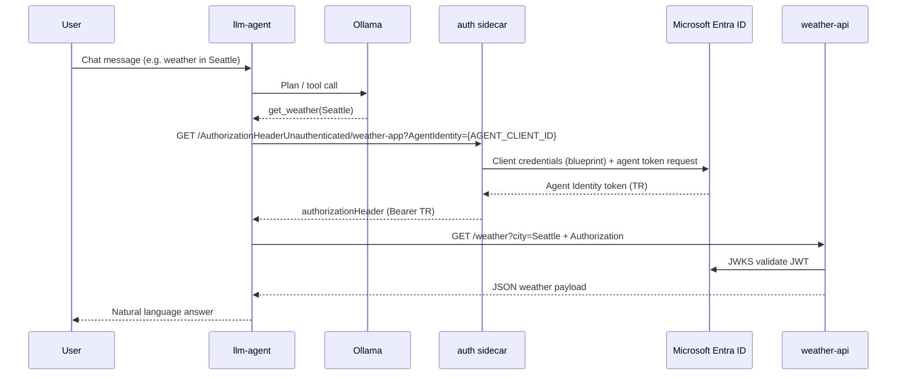

# Lab1 — Entra Agent ID sidecar stack

This folder runs a small **Docker Compose** lab that shows the **auth sidecar pattern** for Microsoft Entra **Agent ID**. The agent application never stores blueprint secrets or performs token exchange itself; it asks the sidecar for an `Authorization` header and then calls a downstream API.

This README describes the **autonomous (app-only)** path only: the chat UI runs in autonomous mode, with no signed-in user and no on-behalf-of (OBO) exchange.

## What you are proving

End to end, a LangGraph-style agent can:

1. Decide to call a tool (weather lookup).
2. Obtain an **Agent Identity token (TR)** from the Entra auth sidecar.
3. Call a downstream API that **cryptographically validates** that token.

If validation succeeds, the response includes real weather from Open-Meteo. If the sidecar or Entra configuration is wrong, the weather API returns `401` and the UI shows where the flow broke.

## Components

| Container | Role in the autonomous flow |
|-----------|-----------------------------|
| **llm-agent** | Flask chat UI + LangChain agent. Host port **3003**. Holds **no** blueprint client secret. |
| **sidecar** | `mcr.microsoft.com/entra-sdk/auth-sidecar` — client credentials as the **blueprint** app, mints **TR** for the configured **agent** app id. **Not published to the host** (in-cluster only). |
| **weather-api** | Sample downstream API. Validates `Bearer` JWT (signature, issuer, audience, agent claims). |
| **ollama** | Local LLM for tool-calling demos (optional for understanding the identity path; weather still hits the real API). |

## Scripts (`Lab1/scripts`) and this sidecar stack

The **`sidecar/`** folder is only the **runtime**: containers, sample agent, and sample downstream API. It does **not** create anything in Microsoft Entra. That work lives in **`Lab1/scripts/`**, chiefly the Jupyter notebook [`entra-agent-id-setup.ipynb`](../scripts/entra-agent-id-setup.ipynb).

Think of two layers:

| Layer | Location | What it does |
|-------|----------|----------------|
| **Tenant setup** | `Lab1/scripts/` | Graph calls to create the blueprint, blueprint secret, Agent Identity, and Weather API app registration; prints IDs you need later. |
| **Runtime lab** | `Lab1/sidecar/` (this folder) | Reads those IDs from `.env` and runs Docker Compose so the sidecar can mint tokens and the agent can call `weather-api`. |

**Order matters.** Do not run `docker compose` first and then try to invent `.env` values by hand—the sidecar and `weather-api` will fail token and audience checks until Entra matches the notebook output.

### Recommended workflow

1. **Notebook (Entra)** — From `Lab1/scripts/`, open [`entra-agent-id-setup.ipynb`](../scripts/entra-agent-id-setup.ipynb) and run cells **in order**:
   - Part 1: Agent ID blueprint, client secret, Agent Identity.
   - Part 2: Weather API app, application ID URI (`api://...`), service principal.
   - Summary / `lab_context` cell (confirm IDs; do not commit outputs with secrets).

2. **Populate `.env` (bridge)** — Still in the notebook, run the **“Update sidecar `.env`”** cells (or copy from `lab_context` into `sidecar/.env`). That file is the **only link** between scripts and Compose: same tenant, blueprint, agent, and weather API app IDs the notebook created.

3. **Sidecar stack (Docker)** — From **`Lab1/sidecar/`**, run `docker compose up`. Containers use `.env`; they never call back into the notebook.

```
Lab1/scripts/entra-agent-id-setup.ipynb     Lab1/sidecar/
         │                                          │
         │  Microsoft Graph                         │
         ▼                                          │
   Entra tenant objects                             │
   (blueprint, agent, weather API)                   │
         │                                          │
         │  writes IDs + secret                      │
         └──────────────►  .env  ──────────────────►│  docker compose
                                                     │  (sidecar + llm-agent + weather-api)
```

Re-running Compose after a notebook **re-run** (new suffix / new apps): update `.env` again from the latest notebook output, then `docker compose up` (rebuild if you changed code only).

Install notebook deps once: `pip install -r ../scripts/requirements.txt` (paths are documented in the notebook).

## Sidecar pattern (why it exists)

```
┌─────────────────────────────────────────────────────────────────┐
│  Trust boundary (e.g. same pod / same Docker network)            │
│                                                                  │
│  ┌──────────────┐    HTTP (no secret)     ┌──────────────────┐  │
│  │  llm-agent   │ ──────────────────────► │  auth sidecar    │  │
│  │  (agent app) │   "Give me a header     │  (blueprint app  │  │
│  │              │    for weather-app"     │   + secret)      │  │
│  └──────┬───────┘                         └────────┬─────────┘  │
│         │                                          │             │
│         │  Bearer TR                               │  Entra ID   │
│         ▼                                          ▼             │
│  ┌──────────────┐                         (token mint / exchange) │
│  │ weather-api  │                                                  │
│  └──────────────┘                                                  │
└─────────────────────────────────────────────────────────────────┘
```

**Division of responsibility**

| Concern | Agent (`llm-agent`) | Sidecar |
|--------|---------------------|---------|
| Blueprint `client_secret` | Never | Held in env / compose |
| MSAL, JWKS, token cache | Never | Handled by sidecar |
| Which agent identity to use | Passes `AgentIdentity=<AGENT_CLIENT_ID>` | Uses blueprint to obtain TR for that agent |
| HTTP call to business API | Yes, with returned header | No |

That split is the point of the lab: agent code stays ordinary application logic; identity specialists operate one sidecar image the same way across hosts and clouds.

## Autonomous token flow

When the user asks for weather, the tool path in `llm-agent/app.py` runs roughly as follows.



**Tokens (autonomous only)**

| Label | Meaning in this lab |
|-------|---------------------|
| **Blueprint app** | Entra app registration with the client secret used only inside the sidecar (`BLUEPRINT_APP_ID`, `BLUEPRINT_CLIENT_SECRET`). |
| **Agent app** | The Agent Identity your tool represents (`AGENT_CLIENT_ID`). Passed on every sidecar request as `AgentIdentity`. |
| **TR** | Access token returned to the agent and sent to `weather-api`. Audience should match `api://<WEATHER_API_APP_ID>`. |

The UI’s debug panel labels these steps (tool call → sidecar → API) so you can correlate logs with Entra sign-in and API logs.

## How Compose wires autonomous mode

In `docker-compose.yml`, the sidecar downstream API name **`weather-app`** must match what the agent requests in code:

- Agent: `.../AuthorizationHeaderUnauthenticated/weather-app?AgentIdentity=...`
- Sidecar: `DownstreamApis__weather-app__BaseUrl`, `DownstreamApis__weather-app__Scopes__0=api://${WEATHER_API_APP_ID}/.default`, and `DownstreamApis__weather-app__RequestAppToken=true` for app-only token acquisition.

`weather-api` sets `EXPECTED_AUDIENCE=api://${WEATHER_API_APP_ID}` so `aud` on **TR** matches the custom API you registered in the notebook.

The sidecar has **no `ports:` mapping** on purpose — see [Agent ID SDK security guidance](https://learn.microsoft.com/en-us/entra/msidweb/agent-id-sdk/security). Only `llm-agent` talks to it on `http://sidecar:5000` inside `agent-network-dev`.

## Quick start

After you complete the [scripts → `.env` → Compose workflow](#scripts-lab1scripts-and-this-sidecar-stack) above:

From **`Lab1/sidecar/`**:

```bash
# If the notebook did not create .env yet:
cp .env.example .env
# Then run the notebook’s “Update sidecar .env” cells, or paste values from lab_context

docker compose up --build -d
```

Open **http://localhost:3003**, keep **Autonomous** selected, and ask for weather in a supported city (see [`weather-api/app.py`](weather-api/app.py) for the city list).

Useful checks:

```bash
docker compose ps
docker compose logs -f llm-agent sidecar weather-api
```

## Environment variables (autonomous minimum)

| Variable | Used by | Purpose |
|----------|---------|---------|
| `TENANT_ID` | sidecar, weather-api, llm-agent | Entra tenant |
| `BLUEPRINT_APP_ID` | sidecar | Client id for blueprint client credentials |
| `BLUEPRINT_CLIENT_SECRET` | sidecar | Blueprint secret (never pass to llm-agent) |
| `AGENT_CLIENT_ID` | llm-agent → sidecar query | Agent Identity app id |
| `WEATHER_API_APP_ID` | sidecar scopes, weather-api `EXPECTED_AUDIENCE` | Custom API registration for the sample |

See [`.env.example`](.env.example) for the full template.

## Deeper dives

- Downstream validation and claims: [`weather-api/README.md`](weather-api/README.md)
- Agent UI, tools, and implementation: [`llm-agent/`](llm-agent/) (`app.py`, `templates/`)

## Troubleshooting (autonomous)

| Symptom | Likely cause |
|---------|----------------|
| Sidecar errors in `llm-agent` debug log | Wrong blueprint secret, agent not linked to blueprint, or `AGENT_CLIENT_ID` mismatch |
| `401` from weather-api | `WEATHER_API_APP_ID` / audience drift between `.env`, sidecar scopes, and `EXPECTED_AUDIENCE` |
| Agent never calls the tool | Ollama not ready or model not pulled; check `ollama` logs |
| Connection refused to sidecar | Compose network issue; confirm `SIDECAR_URL=http://sidecar:5000` in llm-agent |

For first-time issues, finish the notebook and confirm `.env` matches `lab_context` before debugging containers.