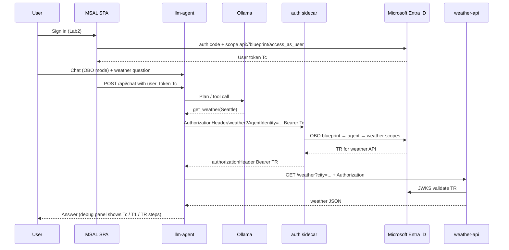

# Lab2 — Entra Agent ID sidecar stack (OBO)

This folder runs a **Docker Compose** lab for Microsoft Entra **Agent ID** with **on-behalf-of (OBO)**. A user signs into a **client SPA** in the browser; the agent forwards the user token to the auth sidecar, which exchanges it for an **Agent Identity token (TR)** for the downstream Weather API. The agent never holds blueprint secrets.

This lab is centered on OBO.

## What you are proving

End to end, with a signed-in user:

1. The chat UI uses **MSAL.js** to get a user token (**Tc**) scoped to the blueprint API (`api://<BLUEPRINT_APP_ID>/access_as_user`).
2. The agent calls the sidecar’s **authenticated** endpoint with **Tc** and obtains **TR** for the weather resource.
3. **weather-api** validates **TR** (JWKS, issuer, audience, agent claims) and returns data.

If Entra, consent, or `.env` values are wrong, the UI debug panel and container logs show where the chain broke.

## Components

| Container | Role in the OBO flow |
|-----------|----------------------|
| **llm-agent** | Flask chat UI + MSAL sign-in + LangChain agent. Host port **3003**. Sends **Tc** to the sidecar for OBO; holds **no** blueprint secret. |
| **sidecar** | `mcr.microsoft.com/entra-sdk/auth-sidecar` — blueprint client credentials; **OBO** on `AuthorizationHeader/weather`; optional autonomous path on `AuthorizationHeaderUnauthenticated/weather-app`. **Not exposed on the host.** |
| **weather-api** | Sample API; validates Bearer JWT. For OBO, expect delegated-style tokens for `api://<WEATHER_API_APP_ID>`. |
| **ollama** | Local LLM for tool demos (weather still uses the real API). |

## Scripts (`Lab2/scripts`) and this stack

Entra setup is **not** done by Compose. Run the PowerShell scripts in order, then fill [`.env`](.env):

| Step | Script | Purpose |
|------|--------|---------|
| 1 | [`entra-agent-blueprint-identity-setup.ps1`](../scripts/entra-agent-blueprint-identity-setup.ps1) | Blueprint, secret, Agent Identity |
| 2 | [`weather-api-setup.ps1`](../scripts/weather-api-setup.ps1) | Weather API + delegated `weather.read` + agent consent |
| 3 | [`client-spa-setup.ps1`](../scripts/client-spa-setup.ps1) | MSAL client SPA (`CLIENT_SPA_APP_ID`) |
| 4 | [`client-blueprint-obo-setup.ps1`](../scripts/client-blueprint-obo-setup.ps1) | Blueprint `access_as_user` + SPA → blueprint consent |

Details: [`Lab2/scripts/README.md`](../scripts/README.md).

```text
Lab2/scripts/*.ps1  →  you copy IDs + secret  →  Lab2/sidecar/.env  →  docker compose
```

## Sidecar pattern (OBO)

```
┌──────────────────────────────────────────────────────────────────────────┐
│  Browser (MSAL)          llm-agent              sidecar           weather-api
│  Sign-in → Tc     →   Bearer Tc + request  →  OBO exchange  →  Bearer TR
│  aud: blueprint API      /AuthorizationHeader/weather
└──────────────────────────────────────────────────────────────────────────┘
```

| Concern | Agent (`llm-agent`) | Sidecar |
|--------|---------------------|---------|
| Blueprint `client_secret` | Never | In Compose env only |
| User sign-in (MSAL) | Browser; `CLIENT_SPA_APP_ID` from env | No |
| User token **Tc** | From client; sent as `Authorization` to sidecar | Validates and runs OBO |
| Agent identity | `AgentIdentity=<AGENT_CLIENT_ID>` on sidecar URL | Mints **TR** for weather downstream |
| Call to **weather-api** | Yes, with returned header | No |

## OBO token flow



**Tokens in this lab**

| Label | Meaning |
|-------|---------|
| **Tc** | User access token from MSAL (`CLIENT_SPA_APP_ID`). Audience is the **blueprint** API (`api://<BLUEPRINT_APP_ID>`). Scope includes `access_as_user`. |
| **T1** | Blueprint token used inside the sidecar during OBO (shown in UI debug when OBO is selected). |
| **TR** | Token sent to **weather-api**. Audience should match `EXPECTED_AUDIENCE` (`api://<WEATHER_API_APP_ID>` or as configured). |
| **Blueprint app** | `BLUEPRINT_APP_ID` + secret in sidecar only. |
| **Agent app** | `AGENT_CLIENT_ID` on sidecar query string. |

MSAL in the UI loads config from the agent (`/api/msal-config`): tenant, `CLIENT_SPA_APP_ID`, and `obo_scopes` = `api://<BLUEPRINT_APP_ID>/access_as_user`.

## How Compose wires OBO

In [`docker-compose.yml`](docker-compose.yml):

- **OBO downstream** — name `weather` (must match `llm-agent` OBO sidecar path):
  - `DownstreamApis__weather__BaseUrl` → `http://weather-api:8080/`
  - `DownstreamApis__weather__Scopes__0` → `api://${WEATHER_API_APP_ID}/.default`
  - No `RequestAppToken=true` (delegated / OBO path).
- **Autonomous (compose only)** — name `weather-app` with `RequestAppToken=true` remains in compose for shared sample code; the **Lab2 chat UI disables Autonomous** (OBO only)—see [`llm-agent/templates/index.html`](llm-agent/templates/index.html). For app-only, use [Lab1](../../Lab1/sidecar/README.md).
- **weather-api** — `EXPECTED_AUDIENCE=api://${WEATHER_API_APP_ID}` in compose (must match `aud` on **TR**).
- **llm-agent** — `CLIENT_SPA_APP_ID`, `BLUEPRINT_APP_ID`, `AGENT_APP_ID` (from `AGENT_CLIENT_ID`), `TENANT_ID`.

The sidecar has **no host ports** — see [Agent ID SDK security](https://learn.microsoft.com/en-us/entra/msidweb/agent-id-sdk/security). The agent uses `http://sidecar:5000` on the Compose network.

## Quick start

1. Complete all four scripts in [`Lab2/scripts/README.md`](../scripts/README.md). Copy [`.env.example`](.env.example) to [`.env`](.env) early (at least `TENANT_ID` before step 2) and fill all IDs after step 4, including `CLIENT_SPA_APP_ID`.
2. From `Lab2/sidecar/`:

```bash
docker compose up --build -d
```

3. Open **http://localhost:3003**.
4. **Sign in** (MSAL), select **OBO** (not Autonomous), ask for weather in a supported city (see [`weather-api/app.py`](weather-api/app.py)).

```bash
docker compose ps
docker compose logs -f llm-agent sidecar weather-api
```

## Environment variables (OBO minimum)

| Variable | Used by | Purpose |
|----------|---------|---------|
| `TENANT_ID` | sidecar, weather-api, llm-agent, MSAL | Entra tenant |
| `BLUEPRINT_APP_ID` | sidecar, llm-agent (MSAL `aud`/scopes) | Blueprint app; sidecar `ClientId` |
| `BLUEPRINT_CLIENT_SECRET` | sidecar | Blueprint secret (not in llm-agent) |
| `AGENT_CLIENT_ID` | llm-agent → sidecar | Agent Identity app id |
| `WEATHER_API_APP_ID` | sidecar scopes, weather-api audience | Custom weather API |
| `CLIENT_SPA_APP_ID` | llm-agent / MSAL | User sign-in application |

Copy `CLIENT_SPA_APP_ID` from [`client-spa-setup.ps1`](../scripts/client-spa-setup.ps1) output into [`.env`](.env).

## Deeper dives

- Token validation: [`weather-api/app.py`](weather-api/app.py)
- Agent, MSAL, OBO tools: [`llm-agent/app.py`](llm-agent/app.py), [`llm-agent/templates/index.html`](llm-agent/templates/index.html)

## Troubleshooting (OBO)

| Symptom                                       | Likely cause                                                                                                                                 |
| --------------------------------------------- | -------------------------------------------------------------------------------------------------------------------------------------------- |
| “Sign in first” / missing user token          | OBO selected but MSAL sign-in failed or `CLIENT_SPA_APP_ID` wrong                                                                            |
| AADSTS65001 or consent errors                 | Run [`client-blueprint-obo-setup.ps1`](../scripts/client-blueprint-obo-setup.ps1); check SPA → blueprint consent                             |
| Sidecar 401 on `/AuthorizationHeader/weather` | **Tc** not for blueprint `access_as_user`, or blueprint URI/scope mismatch                                                                   |
| `401` from weather-api                        | `WEATHER_API_APP_ID` / `EXPECTED_AUDIENCE` drift; OBO `weather.read` consent via [`weather-api-setup.ps1`](../scripts/weather-api-setup.ps1) |
| OBO tool call fails after sign-in             | OBO uses sidecar downstream name `weather`, not `weather-app`; confirm compose `DownstreamApis__weather__*` and `AuthorizationHeader/weather` in [`llm-agent/app.py`](llm-agent/app.py) |
| Connection refused to sidecar                 | `SIDECAR_URL=http://sidecar:5000` on the agent network                                                                                       |

Confirm [`.env`](.env) matches the latest [`Lab2/scripts`](../scripts/README.md) output before debugging containers.