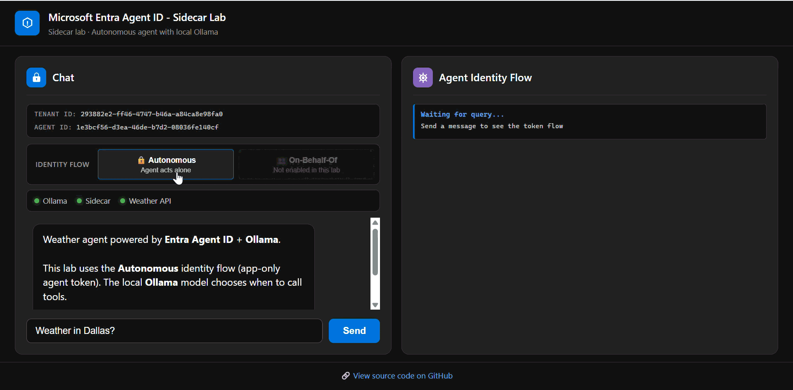
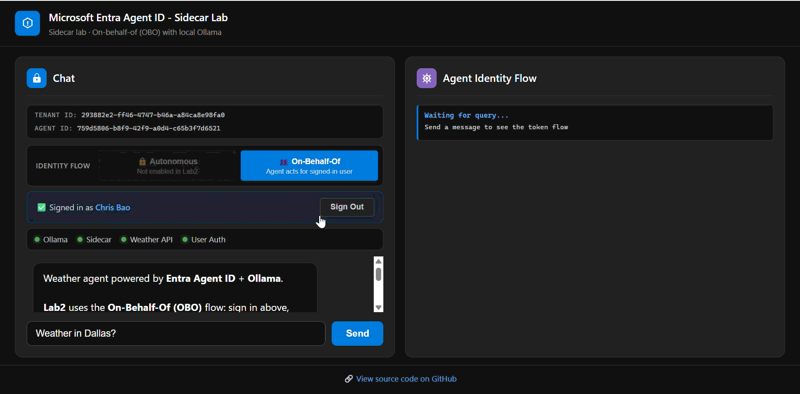

# Entra Agent ID Sidecar Lab

Hands-on labs for securing AI agents with Microsoft Entra **Agent ID**: a sample LLM agent, the official **auth sidecar** (token acquisition and exchange), and a JWT-validating downstream API—covering how agents get **Agent Identity** tokens for API calls, including **autonomous (app-only)** and **on-behalf-of (OBO)** patterns supported by the sidecar.

## Who this is for

- **Agent and app developers** — See how to call tools and APIs without putting blueprint `client_secret`, MSAL, or token caching in your agent code.
- **Identity and platform engineers** — Get a runnable reference for the [Entra Agent ID auth sidecar](https://learn.microsoft.com/en-us/entra/msidweb/agent-id-sdk/overview) on Docker Compose, with a sample resource API that validates Agent Identity tokens.

## What this repository contains

This repo is a growing set of hands-on labs for **Entra Agent ID** and the **auth sidecar** pattern. Each lab is self-contained under its own `LabN/` folder.

Agents need **Agent Identity** tokens for downstream APIs. Blueprint credentials and token exchange belong in a **sidecar** in the same trust boundary as the agent—not in application code.

### Lab1 — Sidecar stack (available)

1. **[`Lab1/scripts/`](Lab1/scripts/)** — PowerShell scripts provision blueprint, Agent Identity, and Weather API app registration in Entra via Microsoft Graph.
2. **[`Lab1/sidecar/`](Lab1/sidecar/)** — Docker Compose runs the official auth sidecar, a LangChain/Ollama sample agent, and a weather API that validates tokens.

**Start here for setup and runtime:** [`Lab1/sidecar/README.md`](Lab1/sidecar/README.md).

### Lab2 — Sidecar stack, on-behalf-of (OBO) (available)

1. **[`Lab2/scripts/`](Lab2/scripts/)** — PowerShell scripts provision blueprint, Agent Identity, Weather API (delegated), MSAL client SPA, and blueprint `access_as_user` for OBO.
2. **[`Lab2/sidecar/`](Lab2/sidecar/)** — Same Compose pattern as Lab1, with MSAL sign-in in the browser and OBO token exchange through the sidecar.

**Start here for setup and runtime:** [`Lab2/sidecar/README.md`](Lab2/sidecar/README.md) · script order: [`Lab2/scripts/README.md`](Lab2/scripts/README.md).

## Repository layout

| Path | Purpose |
|------|---------|
| [`Lab1/scripts/`](Lab1/scripts/) | Lab1 Entra setup (`entra-agent-blueprint-identity-setup.ps1`, `weather-api-setup.ps1`) |
| [`Lab1/sidecar/`](Lab1/sidecar/) | Lab1 Compose stack (autonomous / app-only) |
| [`Lab2/scripts/`](Lab2/scripts/) | Lab2 Entra setup (blueprint, weather OBO, client SPA, blueprint OBO consent) |
| [`Lab2/sidecar/`](Lab2/sidecar/) | Lab2 Compose stack (OBO with MSAL) |
| [`Lab1/sidecar/llm-agent/`](Lab1/sidecar/llm-agent/), [`Lab2/sidecar/llm-agent/`](Lab2/sidecar/llm-agent/) | Sample agent and chat UI |
| [`Lab1/sidecar/weather-api/`](Lab1/sidecar/weather-api/), [`Lab2/sidecar/weather-api/`](Lab2/sidecar/weather-api/) | Sample downstream API |

## Documentation map

| Topic | Where to read |
|-------|----------------|
| Lab1 workflow, architecture, quick start | [`Lab1/sidecar/README.md`](Lab1/sidecar/README.md) |
| Lab1 Entra provisioning | [`Lab1/scripts/README.md`](Lab1/scripts/README.md) |
| Lab2 OBO workflow, architecture, quick start | [`Lab2/sidecar/README.md`](Lab2/sidecar/README.md) |
| Lab2 Entra provisioning (four scripts) | [`Lab2/scripts/README.md`](Lab2/scripts/README.md) |
| Downstream token validation | [`Lab1/sidecar/weather-api/README.md`](Lab1/sidecar/weather-api/README.md) (same pattern in Lab2) |

## Security

Do not commit [`Lab1/sidecar/.env`](Lab1/sidecar/.env), [`Lab2/sidecar/.env`](Lab2/sidecar/.env), or other files that contain blueprint client secrets. This repo is **sample lab code**, not production guidance.

## Contributing

Issues and pull requests are welcome. Please keep changes focused and update the relevant README when behavior or setup steps change.

## Related Microsoft documentation

- [Entra Agent ID overview](https://learn.microsoft.com/en-us/entra/agent-id/overview-agent-id)
- [Create blueprint](https://learn.microsoft.com/en-us/entra/agent-id/create-blueprint)
- [Agent ID SDK / auth sidecar](https://learn.microsoft.com/en-us/entra/msidweb/agent-id-sdk/overview)
- [Auth sidecar security](https://learn.microsoft.com/en-us/entra/msidweb/agent-id-sdk/security)

## License

This project is licensed under the MIT License. See [LICENSE](LICENSE) for the full text.